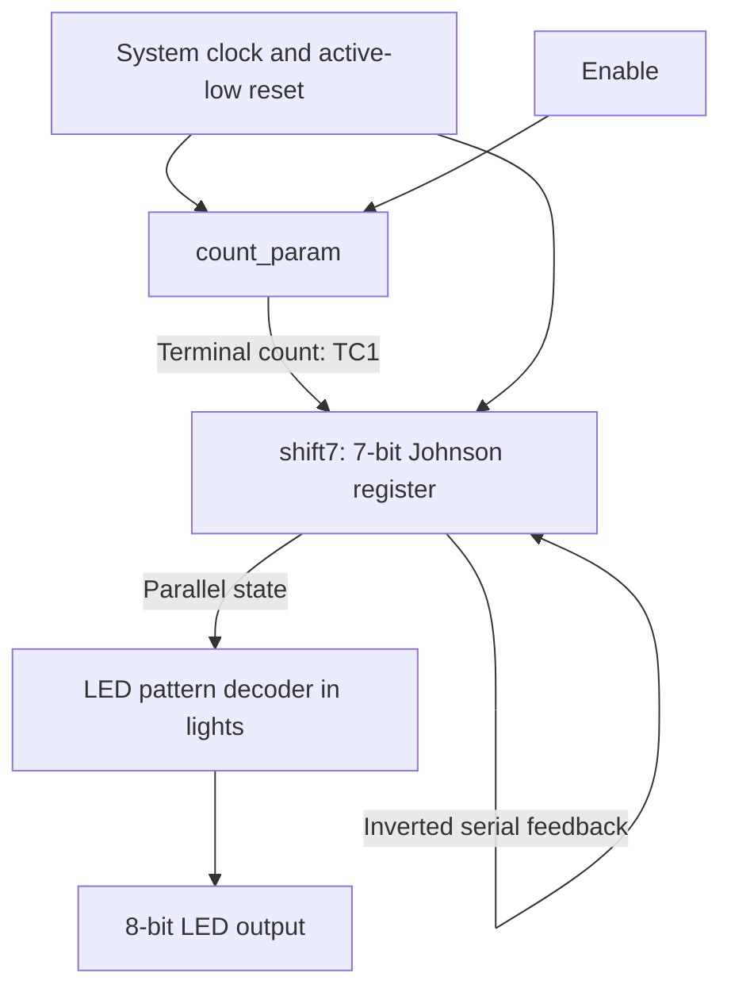

# Verilog LED Sequencer

An eight-LED running-light controller implemented in **Verilog HDL** for the **Terasic DE2-115 FPGA development board**. The design combines a parameterized clock counter, a seven-bit **Johnson shift register**, and combinational LED decoding to produce a repeating, bidirectional light sequence.

The original design was implemented with **Intel/Altera Quartus** and evaluated using **ModelSim** functional and timing simulations. Its behavior was also documented for the DE2-115 hardware.

## Features

- **Bidirectional running-light pattern:** moves a single illuminated LED from one end of the eight-LED array to the other and back.
- **Fourteen-step sequence:** uses the fourteen distinct states of a seven-bit Johnson counter.
- **Configurable step interval:** a parameterized counter produces the shift-enable event.
- **Enable and reset controls:** the sequence can be paused and returned to its initial LED pattern.
- **Reusable building blocks:** the counter and shift register each have an independent testbench.

## Design architecture



The top-level module, **`lights`**, connects two reusable blocks:

1. **`count_param`** counts clock cycles and asserts a terminal-count signal. The top-level parameter `Cuenta` determines how frequently the LEDs advance.
2. **`shift7`** shifts a new bit into the register when terminal count is asserted. Feeding back the inverted serial output produces a Johnson-counter sequence.

A combinational decoder in `lights` maps the fourteen register states to an eight-bit, one-LED-at-a-time output.

With the original **50 MHz** board clock and `Cuenta = 12_500_000`, the intended LED step interval is **0.25 seconds**. Testbenches override the parameter with a smaller value to shorten simulation time.

## RTL modules

| Module | Responsibility |
| --- | --- |
| [`lights.v`](rtl/lights.v) | Top-level sequencer, counter/register integration, and 14-state-to-LED decoding. |
| [`count_param.v`](rtl/count_param.v) | Parameterized up/down counter with enable, synchronous active-low reset, and terminal-count output. |
| [`shift7.v`](rtl/shift7.v) | Seven-bit serial-in/serial-out shift register with parallel output and synchronous active-low reset. |

### Top-level interface

| Signal | Direction | Description |
| --- | --- | --- |
| `iCLK` | Input | System clock. |
| `iRST_n` | Input | Active-low synchronous reset. |
| `iENABLE` | Input | Enables or pauses sequence progression. |
| `oLED[7:0]` | Output | Eight-bit LED pattern. |

The top-level parameter **`Cuenta`** sets the timing-counter modulus; `shift7` has a configurable register-width parameter `n` (used as seven bits in this design).

## Functional verification

The repository includes three Verilog testbenches:

| Testbench | Scenarios covered |
| --- | --- |
| [`tb_count.v`](tb/tb_count.v) | Up-counting, down-counting, synchronous reset, enable behavior, and terminal count. |
| [`tb_shift7.v`](tb/tb_shift7.v) | Serial shifting, seven-bit parallel output, synchronous reset, and shift enable. |
| [`tb_lights.v`](tb/tb_lights.v) | Fourteen-step running-light sequence, reset to the first LED, and sequence pause/resume. |

The original verification included **functional and timing waveform inspection in ModelSim**. The testbenches mainly generate stimulus and display case markers; they are **not fully automated assertion-based regression tests**. The original documentation also describes hardware-level validation of the LED direction, reset, and enable behavior.

## Development environment

| Item | Details |
| --- | --- |
| FPGA development board | Terasic DE2-115 |
| FPGA family | Intel/Altera Cyclone IV E |
| Hardware description language | Verilog HDL |
| FPGA design | Intel/Altera Quartus |
| Simulation | ModelSim |
| Nominal board clock | 50 MHz |

## Repository layout

```text
Verilog-LED-Sequencer/
├── rtl/
│   ├── count_param.v
│   ├── lights.v
│   └── shift7.v
├── tb/
│   ├── tb_count.v
│   ├── tb_lights.v
│   └── tb_shift7.v
└── README.md
```

## Reusing the design

Create a Quartus project targeting the DE2-115's FPGA device, add the three files in `rtl/`, and select **`lights`** as the top-level entity. Restore the appropriate clock, reset, enable-switch, and LED pin assignments from the board documentation. For simulation, compile the same RTL sources alongside one of the testbenches in `tb/` and select that testbench as the simulation top.

**Scope:** This repository contains the HDL sources and testbenches, not the original full Quartus project, pin assignments, timing constraints, or compiled FPGA bitstreams. Rebuilding for hardware requires recreating those project settings. The original verification is documented; the sources have not been rerun as part of this README revision.

